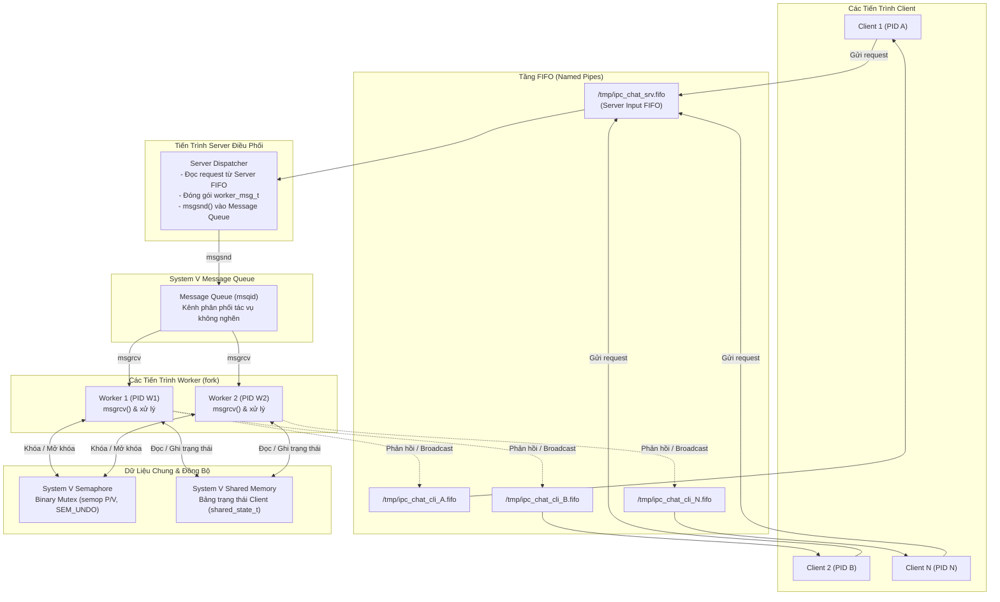

# Kiến Trúc Hệ Thống: Multi-Process Chat IPC trên Linux

Tài liệu này mô tả chi tiết kiến trúc kỹ thuật của hệ thống Chat Đa Tiến Trình (Multi-Process Chat) sử dụng các cơ chế Giao tiếp Liên tiến trình (IPC) cục bộ trên hệ điều hành Linux bằng ngôn ngữ C.

---

## 1. Sơ đồ kiến trúc tổng thể

---

## 2. Vai trò chi tiết của 4 cơ chế IPC

| Cơ chế IPC | File triển khai | Vai trò kỹ thuật trong hệ thống |
|---|---|---|
| **FIFO (Named Pipe)** | `src/fifo_ipc.c` | - **Server FIFO** (`/tmp/ipc_chat_srv.fifo`): Tiếp nhận mọi yêu cầu đăng ký, tin nhắn và lệnh từ các Client. - **Client FIFO** (`/tmp/ipc_chat_cli_<pid>.fifo`): Kênh nhận phản hồi và tin nhắn riêng biệt cho từng Client, tránh xung đột dữ liệu giữa các Client. - **Tính nguyên tử**: Kích thước gói tin `chat_msg_t` (~700 bytes) được thiết kế nhỏ hơn `PIPE_BUF` (4096 bytes trên Linux) đảm bảo thao tác ghi vào Server FIFO là nguyên tử (atomic), không bị trộn lẫn dữ liệu giữa nhiều client ghi đồng thời. |
| **System V Message Queue** | `src/msg_queue.c` | - Tách biệt tầng tiếp nhận (Dispatcher) và tầng xử lý (Worker). - Dispatcher không phải xử lý logic nặng mà chỉ cần `msgsnd()` vào queue rồi quay lại đọc FIFO ngay, đảm bảo thông lượng cao và không nghẽn cổ chai. - Các Worker cạnh tranh nhận việc qua `msgrcv()`, tự động cân bằng tải. |
| **System V Shared Memory** | `src/shared_memory.c` | - Lưu trữ cấu trúc `shared_state_t` bao gồm bảng danh sách các Client (`client_info_t`), trạng thái online/offline, nickname, PID và đường dẫn FIFO riêng. - Cho phép tất cả các Worker truy xuất thông tin người dùng với độ trễ cực thấp (zero-copy trong RAM). |
| **System V Semaphore** | `src/semaphore.c` | - Semaphore nhị phân (Binary Mutex) khởi tạo giá trị 1. - Bảo vệ vùng Shared Memory khi nhiều Worker cùng cập nhật danh sách client (đăng ký mới, đăng xuất, dọn dẹp). - Sử dụng cờ `SEM_UNDO` của kernel Linux: nếu một tiến trình Worker bị crash đột ngột khi đang giữ lock, hệ điều hành tự động hoàn tác (release lock), ngăn chặn hoàn toàn nguy cơ deadlock vĩnh viễn. |

---

## 3. Quản lý vòng đời tiến trình & Tín hiệu (Signals)

Hệ thống kết hợp các system call quản trị tiến trình chuẩn của Linux POSIX:

1. **`fork()`**: Server tạo ra `WORKER_COUNT` (mặc định 2) tiến trình Worker con lúc khởi động.
2. **`waitpid()` & `SIGCHLD`**:
   - Server đăng ký handler cho tín hiệu `SIGCHLD` với cờ `SA_RESTART | SA_NOCLDSTOP`.
   - Vòng lặp `while (waitpid(-1, NULL, WNOHANG) > 0)` thu hồi các tiến trình con kết thúc để tránh tạo ra tiến trình ma (zombie process).
3. **`SIGINT` / `SIGTERM`**:
   - Khi nhận tín hiệu tắt (Ctrl+C hoặc lệnh `kill`):
     1. Server phát thông báo shutdown tới toàn bộ client online qua FIFO.
     2. Gửi tín hiệu `SIGTERM` tới tất cả các PID của Worker và đợi thu hồi (`waitpid`).
     3. Đóng và xóa Server FIFO (`unlink`).
     4. Hủy Message Queue (`msgctl IPC_RMID`).
     5. Tách và hủy Shared Memory (`shmdt`, `shmctl IPC_RMID`).
     6. Hủy Semaphore (`semctl IPC_RMID`).
4. **Phát hiện Client chết đột ngột (Orphan Client Detection)**:
   - Trong quá trình phát tán tin nhắn hoặc duyệt danh sách `/list`, Worker sử dụng system call `kill(pid, 0)`.
   - Nếu trả về `-1` với lỗi `ESRCH` (No such process), Worker nhận diện Client đã bị kill đột ngột, tự động xóa slot trong Shared Memory và giảm biến đếm số lượng người online.
   - Khi ghi vào Client FIFO nếu gặp `EPIPE` (Broken Pipe), hệ thống cũng tự động đánh dấu Client offline.
